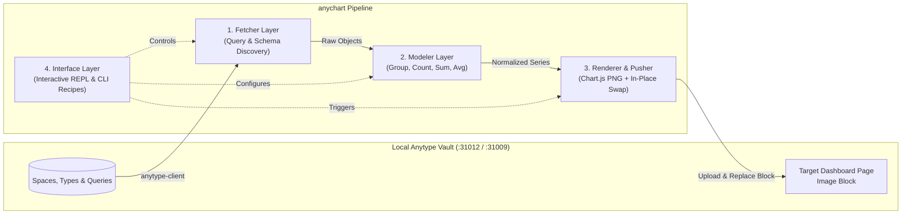

# anychart

**Automated, cross-platform data visualization charts for Anytype.**

`anychart` queries your local Anytype vault, models object properties on a case-by-case basis, renders high-DPI **Chart.js** graphs (bar, pie, doughnut, line), and updates native **Image blocks** in-place on your Anytype pages—syncing seamlessly across both **Anytype Desktop** and **Anytype Mobile**.

---

## Why `anychart` Exists (The Pitch)

Anytype is built around a **local-first, end-to-end encrypted (E2EE)** architecture. While this guarantees privacy and data ownership, it also means Anytype does not support third-party cloud plugins or browser-style extensions, and native database analytics remain limited:

1. **No Native Collection Analytics Charts:** Anytype's built-in *Graph View* visualizes node-link relationships between objects rather than quantitative bar or pie charts. Grid views only offer basic column footer totals, and Kanban boards only group by a single Select property.
2. **Broken & Desktop-Only `/chart` Embeds:** Anytype's experimental `/chart` embed block is **not supported on Anytype Mobile** (displaying an *"unsupported block"* placeholder) and frequently renders as a blank white canvas on Desktop builds.
3. **Mermaid Limitations:** While `/mermaid` blocks render across Desktop and Mobile, Mermaid lacks universal native bar chart support—forcing awkward Gantt-chart workarounds for basic category counts.
4. **Page Clutter from Manual Exports:** Exporting CSVs to external spreadsheets or generating new Anytype pages on every script run breaks live dashboard workflows.

### How `anychart` Solves This

Instead of relying on fragile embed blocks or external cloud dashboards, `anychart` treats **native Anytype Image blocks** as dynamic chart canvases:

* **True Chart.js Fidelity:** Renders crisp bar, pie, line, and doughnut charts locally or via QuickChart.
* **100% Desktop & Mobile Parity:** Standard Image blocks live inside your encrypted Anytype vault and render natively on macOS, Windows, Linux, iOS, and Android.
* **In-Place Updates:** Locates an existing Image block on a target dashboard page and swaps its file reference (`target_object_id`) in-place—updating your charts with zero duplicate blocks or broken links.
* **Interactive + Automated:** Designed to support both an interactive REPL shell for ad-hoc exploration and saved JSON recipes for hands-free background updates via `anytype serve`.

---

## High-Level Pipeline



---

## Project Status & Roadmap

| Layer / Component | Module | Status | Description |
| :--- | :--- | :--- | :--- |
| **Chart Renderer & Pusher** | `src/chart_push.py` | **Working** | Fetches selected Anytype data, renders a Chart.js distribution to high-DPI PNG, uploads it, and replaces an Image block in-place. |
| **Layer 1: Fetcher** | `src/fetcher.py` | **Working** | Selects an accessible space, then fetches from a saved Query/Collection view or a selected Type. |
| **Layer 2: Modeler** | `src/modeler.py` *(planned)* | **Planned** | Shapes raw Anytype objects on a case-by-case basis (`count`, `sum`, `avg`, `group_by`, time bucketing) into standardized Chart.js datasets. |
| **Layer 3: Shell & CLI** | `src/anychart/shell.py` & `cli.py` | **Planned** | Interactive `cmd.Cmd` REPL for live querying/modeling, plus `save-recipe` / `run` commands for cron-scheduled automation. |

---

## Repository Structure

```text
anychart/
├── README.md                           # Project overview, pitch, status, and quickstart
├── docs/
│   ├── system_architecture_layers.md   # Detailed 4-stage pipeline and layer specifications
│   ├── bot_api_setup_guide.md          # Headless daemon, bot account invite, and /v1 API auth guide
│   └── workflows_examples.md           # Working push example, REPL transcript, and cron recipes
├── src/
│   ├── block_update.py                # Legacy Mermaid block example
│   ├── chart_push.py                   # Interactive chart render and push pipeline
│   ├── fetcher.py                      # Space, Query/Collection, and Type data retrieval
│   ├── image_block.py                  # Image-block update helpers
│   └── tests/
│       ├── test_chart_push.py
│       ├── test_fetcher.py
│       └── test_image_block.py
└── .gitignore                          # Excludes __pycache__/, .env, and temporary *.png outputs
```

---

## Quickstart

### Prerequisites

* Python 3.10+
* `anytype-client` (`charlesneimog/anytype-client`) and `requests`
* Either **Anytype Desktop** running locally (`http://127.0.0.1:31009`) or the headless **Anytype CLI** daemon (`anytype serve` on `http://127.0.0.1:31012`)

### Installation

```bash
git clone https://github.com/pennslip-labs/anychart.git
cd anychart
pip install anytype-client requests
```

### Generate and Push a Chart

1. Set your dashboard page ID and unscoped `/v1` API key (see [`docs/bot_api_setup_guide.md`](docs/bot_api_setup_guide.md) for instructions):

```bash
export ANYTYPE_API_URL="http://127.0.0.1:31012"
export ANYTYPE_API_KEY="your_unscoped_v1_api_key"
export ANYTYPE_PAGE_ID="your_dashboard_page_id"
# Optional when the bot can access multiple spaces; otherwise the script asks.
export ANYTYPE_SPACE_ID="your_space_id"
```

2. Execute the chart script. It prompts for a Query/Collection or Type table and a property to group by, then replaces the Image block on your target page. The exported PNG name includes the source, grouping property, and creation date (`DD-MM-YY`):

```bash
python3 src/chart_push.py
```

---

## Documentation

* **[Setup & Bot Authentication](docs/bot_api_setup_guide.md):** How to run `anytype serve`, create and invite a dedicated `anychart-bot` account, generate unscoped `/v1` API keys, and handle `anytype-client` authentication quirks.
* **[System Architecture](docs/system_architecture_layers.md):** Architectural breakdown of the completed push utility and the upcoming Fetcher, Modeler, and Shell/CLI layers.
* **[Workflows & Examples](docs/workflows_examples.md):** Code examples for the current push pipeline, planned interactive shell sessions, and automated recipe execution.
