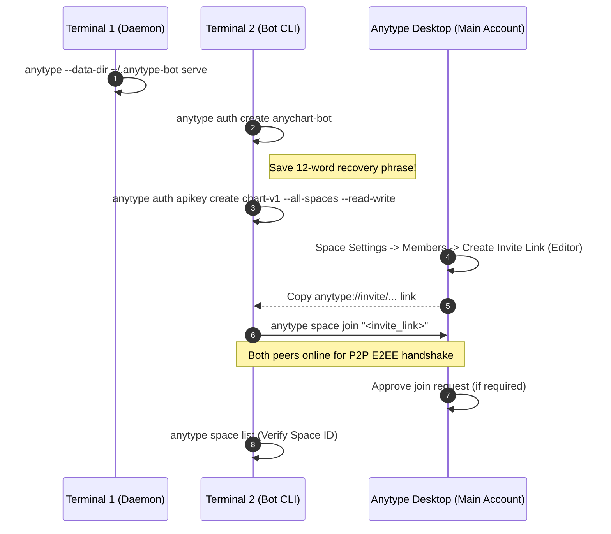

# Headless Daemon, Bot Setup & API Authentication

`anychart` communicates with Anytype exclusively over the **local HTTP JSON API**. Nothing leaves your machine except optional Chart.js rendering requests to QuickChart (which can also be replaced with local headless Chromium via Playwright for 100% offline execution).

---

## 1. Local API Endpoints

Anytype exposes two separate local HTTP port ranges so the GUI app and headless CLI daemon can run side-by-side without port collisions:

| Runtime | Default URL | Port Range | Best Used For |
| :--- | :--- | :--- | :--- |
| **Anytype Desktop App** | `http://127.0.0.1:31009` | `31007–31009` | Interactive desktop testing while the GUI app is open. |
| **Anytype CLI (`anytype serve`)** | `http://127.0.0.1:31012` | `31010–31012` | Background automation, cron jobs, and dedicated bot accounts. |

---

## 2. Setting Up a Dedicated Headless Bot Account

Running a dedicated bot identity via `anytype-cli` isolates automation credentials from your primary account while allowing the bot to act as an **Editor** in shared spaces.



### Step-by-Step Setup

1. **Start the isolated headless server (Terminal 1):**
   ```bash
   anytype --data-dir ~/.anytype-bot serve
   ```
   *(Using `--data-dir` keeps the bot's encrypted keys separate from any other CLI profile on your machine.)*

2. **Create the bot identity and save its recovery phrase (Terminal 2):**
   ```bash
   anytype --data-dir ~/.anytype-bot auth create anychart-bot
   ```
   > **Important:** Immediately copy and store the **12-word recovery phrase** printed in the output. Because Anytype is end-to-end encrypted, there is no way to recover a bot identity if the local data directory is wiped without those 12 words.

3. **Generate an unscoped `/v1` API key:**
   ```bash
   anytype --data-dir ~/.anytype-bot auth apikey create chart-v1 --all-spaces --read-write
   ```
   Save the generated `anytype_...` token in your `.env` file or environment variables.

4. **Invite the bot to your target Space:**
   * Open **Anytype Desktop** (logged into your main account) and navigate to the target Space.
   * Open **Space Settings $\rightarrow$ Members $\rightarrow$ Invite Member $\rightarrow$ Create Invite Link**.
   * Set the role to **Editor** (required so the bot can upload PNG files and update blocks) and copy the `anytype://invite/...` link.
   * With Anytype Desktop still open so both peers can complete the P2P handshake, run in Terminal 2:
     ```bash
     anytype --data-dir ~/.anytype-bot space join "<paste_invite_link_here>"
     ```
   * Verify access with:
     ```bash
     anytype --data-dir ~/.anytype-bot space list
     ```

---

## 3. Critical `anytype-client` Authentication Notes

When using `charlesneimog/anytype-client` (`from anytype import Anytype`), two implementation details must be handled explicitly:

### A. Unscoped `/v1` Keys vs. Space-Scoped `/v2` Keys
Calling `client.auth()` without arguments triggers an interactive 4-digit pairing prompt that issues a **space-scoped key** (`"PythonClient"`). Anytype's `/v1/spaces` endpoints reject space-scoped keys with:
> `ResponseHasError: key "PythonClient" carries a space grant ... which /v1 cannot honor`

Always use an **unscoped key** generated with `--all-spaces --read-write` and bypass interactive `client.auth()`.

### B. Satisfying the `@auth_required` Decorator
`anytype-client` wraps API methods in an `@auth_required` decorator (`anytype/utils.py`) that checks internal token attributes on both `client` and `client._apiEndpoints`. Simply injecting an `Authorization` header is insufficient.

Use the following initialization pattern across `anychart`:

```python
import os
from anytype import Anytype

API_URL = os.getenv("ANYTYPE_API_URL", "http://127.0.0.1:31012")
API_KEY = os.environ["ANYTYPE_API_KEY"]

client = Anytype()
client.api_url = API_URL
client.token = API_KEY

if hasattr(client, "_apiEndpoints"):
    client._apiEndpoints.api_url = API_URL
    client._apiEndpoints.token = API_KEY
    if hasattr(client._apiEndpoints, "_headers"):
        client._apiEndpoints._headers["Authorization"] = f"Bearer {API_KEY}"

if hasattr(client, "_headers"):
    client._headers["Authorization"] = f"Bearer {API_KEY}"
```

---

## 4. Extracting Space, Query, and Page IDs

Anytype object links follow the structure:
```text
anytype://object/<OBJECT_ID>?spaceId=<SPACE_ID>
```

* **`PAGE_ID` / `QUERY_ID`:** The `bafyrei...` string immediately following `anytype://object/` and before `?`.
* **`SPACE_ID`:** The `bafyrei...` string following `spaceId=`.

> **Tip:** Never pass the full `anytype://` or `https://object.any.coop/` URL into `space.get_object()`—pass **only** the extracted `bafyrei...` ID string.