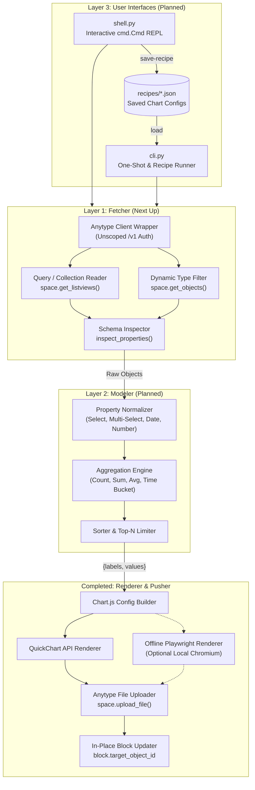

# System Architecture & Layer Specifications

`anychart` is designed around a decoupled, four-stage data pipeline. Separating **data retrieval**, **data modeling**, **chart rendering/pushing**, and **user interfaces** ensures that the exact same core logic powers both interactive terminal sessions and unattended background cron jobs.

---

## End-to-End Component Architecture



---

## Completed Foundation: Chart Renderer & In-Place Pusher

**Current Location:** `src/tests/test_chart_push.py` *(to be refactored into `src/anychart/pusher.py`)*

The bottom of the pipeline is built and verified:
1. **Chart.js Payload Construction:** Builds a standard Chart.js configuration dictionary (`type`, `data.labels`, `data.datasets`, `options`).
2. **High-DPI PNG Rendering:**
   * **Primary (`QuickChart`):** POSTs the Chart.js JSON payload to `https://quickchart.io/chart` at `devicePixelRatio: 2` (`800x450` logical pixels $\rightarrow$ `1600x900` crisp output).
   * **Offline Alternative (`Playwright`):** Renders an HTML `<canvas>` loading local `chart.umd.min.js` in headless Chromium and screenshots `#c` to PNG with zero external network calls.
3. **Vault Upload & In-Place Block Replacement:**
   * Uploads the rendered PNG into the target Anytype space via `space.upload_file(png_path)`.
   * Iterates over `page.blocks` on the target `PAGE_ID` to locate an existing `image` block (`getattr(block, "type", None) == "image"`).
   * Updates `block.target_object_id = uploaded_file.id` and commits via `page.update_block(block)` (falling back to `page.add_image(uploaded_file)` if the page has no Image block yet).

> **Multi-Chart Dashboard Scaling:** When extending dashboards to hold multiple charts on a single page, target specific blocks by matching `block.id` from a recipe mapping rather than overwriting the first `image` block encountered.

---

## Layer 1: Fetching & Schema Discovery (`fetcher.py`) — *Next Up*

Because Anytype spaces contain custom Object Types with arbitrary property schemas, the fetching layer needs to support two complementary retrieval strategies plus live schema discovery:

### 1. Query / Collection Retrieval (Recommended Default)
Anytype exposes saved **Queries (Sets)** and **Collections** as Lists via `list_id`. Leveraging an existing Anytype Query lets you manage complex date ranges and filters visually inside the Anytype UI without hardcoding filter logic in Python:

```python
def fetch_from_query(space, query_id: str, limit: int = 500) -> list:
    views = space.get_listviews(query_id)
    default_view = views[0]
    return default_view.get_objects(limit=limit)
```

### 2. Dynamic Type & Filter Retrieval
For ad-hoc exploration in the interactive shell without pre-creating a Query in Anytype:

```python
def fetch_by_type(space, type_key: str, extra_filters: dict | None = None, limit: int = 500) -> list:
    filters = {"type": type_key}
    if extra_filters:
        filters.update(extra_filters)
    return space.get_objects(filters=filters, limit=limit)
```

### 3. Live Schema Inspection (`inspect_properties`)
Scans a batch of fetched objects and summarizes every discovered property key, inferred format (`Select`, `Multi-select`, `Number`, `Date`, `String`), and sample values so the user (or REPL) knows which fields can be grouped or summed.

---

## Layer 2: Case-by-Case Modeler (`modeler.py`) — *Roadmap Step 2*

The modeler decouples Anytype's raw object structures from Chart.js dataset formatting:

* **Property Normalization:** Safely extracts values whether stored as direct object attributes (`getattr(obj, key)`) or inside `obj.properties[key]`. Unwraps `Select` / tag objects via `.name`, expands `Multi-select` lists across multiple buckets, and maps `None` values to a configurable fallback (e.g., `"Uncategorized"`).
* **Aggregation Modes:**
  * `count`: Frequency count per category (`group_by`).
  * `sum`: Total of a numeric `value_field` grouped by `group_by` (e.g., expenses summed by category).
  * `avg`: Mean of a numeric `value_field` grouped by `group_by`.
  * `timeseries`: Buckets `Date` properties by day, week, or month.
* **Standardized Output Contract:**
  ```python
  {
      "labels": ["Done", "In Progress", "To Do"],
      "values": [18, 9, 15],
      "meta": {"mode": "count", "group_by": "status", "total_objects": 42}
  }
  ```

---

## Layer 3: Interactive Shell & Recipe CLI (`shell.py` & `cli.py`) — *Roadmap Step 3*

To make case-by-case data modeling intuitive without sacrificing background automation, Layer 3 provides two entry points over the same core modules:

1. **Interactive REPL (`shell.py` via `cmd.Cmd`):**
   * Maintains session state (`current_space`, `loaded_objects`, `modeled_data`, `chart_config`).
   * Commands: `spaces`, `use <space>`, `types`, `fetch`, `props`, `model`, `chart`, `preview`, `push <page_id>`, and `save-recipe <path>`.
2. **Non-Interactive CLI (`cli.py`):**
   * Executes saved JSON recipes (`anychart run recipes/sprint_tasks.json`) for hands-free updates via `cron` or systemd timers.