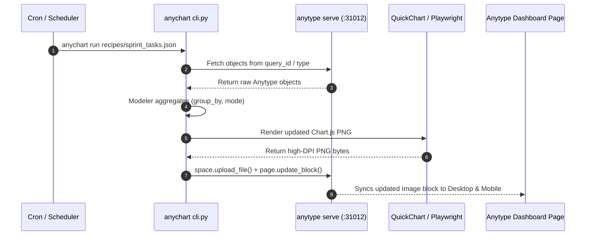

# Workflows & Usage Examples

This document illustrates the interactive source-selection and chart-push workflow, alongside the planned Modeler, Interactive Shell, and automated Recipe CLI.

---

## 1. Current Workflow: Selecting Data, Rendering & Pushing a Chart (Working)

Run `python3 src/chart_push.py` with `ANYTYPE_API_KEY` and `ANYTYPE_PAGE_ID` set. Optionally set `ANYTYPE_SPACE_ID`; otherwise the script selects from accessible spaces. It then asks whether to use a Query/Collection view or a Type table, offers a property to group by, renders a Chart.js bar graph via QuickChart, and replaces an existing Image block in-place. The shared-space client calls are scoped through the selected Anytype space:

```text
$ python3 src/chart_push.py
1. Connecting to Anytype local API...
   -> Using space 'Personal Vault' (bafyreig...)
Fetch from [q]uery/collection or [t]ype? t
Available types:
  [1] Task (task-type-id)
  [2] Note (note-type-id)
Select a type [1-2]: 1
Fetched 42 objects from type 'Task'.
Available properties to graph:
  [0] Count objects by type
  [1] Status
  [2] Priority
Select a property [0-2]: 1
```

---

## 2. Planned Workflow: Interactive Modeling Shell (`shell.py`)

Once the Modeler and shell interface are wired into the `cmd.Cmd` REPL, exploring an unfamiliar space and shaping a chart interactively follows this session flow:

```text
$ python3 -m anychart.shell
Welcome to anychart shell. Type 'help' or '?' to list commands.

anychart> spaces
  [0] Personal Vault (bafyreigwxsgb...)
anychart> use 0
Active space: Personal Vault

anychart> types
  Available types: task, page, note, expense, habit

anychart> fetch --type task
  Fetched 42 objects of type 'task'.

anychart> props
  Discovered properties:
    - status (Select): Done, In Progress, To Do
    - priority (Select): High, Medium, Low
    - estimate (Number): 1.0 .. 8.0
    - due_date (Date)

anychart> model count --group-by status --sort desc
  ┌─────────────┬───────┐
  │ status      │ count │
  ├─────────────┼───────┤
  │ Done        │ 18    │
  │ To Do       │ 15    │
  │ In Progress │ 9     │
  └─────────────┴───────┘

anychart> chart --type bar --title "Sprint Task Breakdown"
  Chart.js config built (type=bar).

anychart> push bafyreihfrv4ks5ah3x3opcwzo6i5kjkydynlnw6mmrp7fac3c6hc5ov4dq
  -> Uploaded PNG and updated Image block in-place!

anychart> save-recipe recipes/sprint_tasks.json
  -> Saved reusable recipe to recipes/sprint_tasks.json
```

---

## 3. Planned Workflow: Automated Recipe Execution (`cli.py` + Cron)

Saving an interactive session as a JSON recipe bridges ad-hoc exploration with scheduled automation:



### Example Recipe File (`recipes/sprint_tasks.json`)

```json
{
  "name": "Sprint Task Breakdown",
  "space_id": "YOUR_SPACE_ID",
  "source": {
    "mode": "query",
    "query_id": "YOUR_QUERY_OR_COLLECTION_ID"
  },
  "model": {
    "aggregation": "count",
    "group_by": "status",
    "fallback": "Uncategorized",
    "sort": "desc"
  },
  "chart": {
    "type": "bar",
    "title": "Sprint Task Breakdown",
    "palette": ["#4CAF50", "#2196F3", "#FF9800", "#9C27B0"]
  },
  "target": {
    "page_id": "YOUR_DASHBOARD_PAGE_ID",
    "block_id": "OPTIONAL_SPECIFIC_IMAGE_BLOCK_ID"
  }
}
```

### Scheduling with Cron

With `anytype --data-dir ~/.anytype-bot serve` running in the background, schedule periodic dashboard refreshes:

```cron
# Refresh the Sprint Task Breakdown chart every 30 minutes
*/30 * * * * cd /path/to/anychart && ANYTYPE_API_KEY="your_key" python3 -m anychart.cli run recipes/sprint_tasks.json >> /tmp/anychart.log 2>&1
```