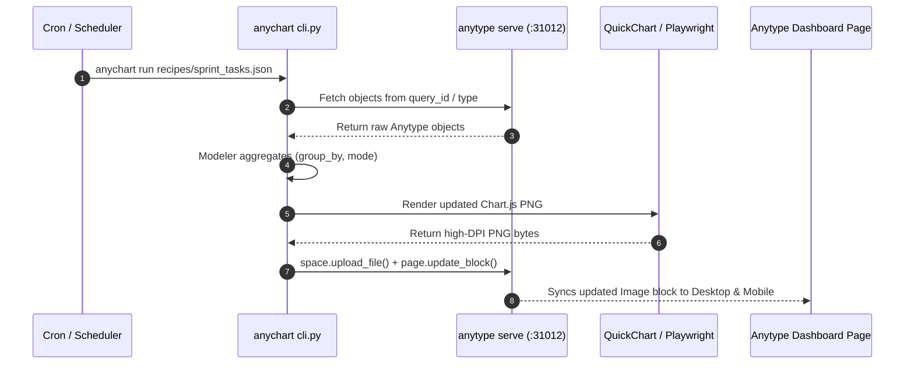

# Workflows & Usage Examples

This document illustrates the current working chart-push workflow alongside the planned workflows for the Fetcher, Modeler, Interactive Shell, and automated Recipe CLI.

---

## 1. Current Workflow: Rendering & Pushing a Chart (Working)

The verified baseline in `src/tests/test_chart_push.py` demonstrates authenticating against the local API with an unscoped `/v1` key, rendering a Chart.js bar graph via QuickChart, and replacing an existing Image block in-place:

```python
import os
import requests
from anytype import Anytype

API_URL = os.getenv("ANYTYPE_API_URL", "http://127.0.0.1:31012")
API_KEY = os.environ["ANYTYPE_API_KEY"]
SPACE_ID = os.environ["ANYTYPE_SPACE_ID"]
PAGE_ID = os.environ["ANYTYPE_PAGE_ID"]
OUTPUT_PNG = "sample_chartjs.png"

# 1. Build Chart.js specification
chart_config = {
    "type": "bar",
    "data": {
        "labels": ["Done", "In Progress", "To Do"],
        "datasets": [
            {
                "label": "Tasks",
                "data": [14, 6, 10],
                "backgroundColor": ["#4CAF50", "#2196F3", "#FF9800"],
                "borderRadius": 6,
            }
        ],
    },
    "options": {
        "plugins": {
            "legend": {"display": False},
            "title": {"display": True, "text": "Task Status Breakdown"},
        },
        "scales": {"y": {"beginAtZero": True}},
    },
}

# 2. Render high-DPI PNG via QuickChart
res = requests.post(
    "https://quickchart.io/chart",
    json={"chart": chart_config, "width": 800, "height": 450, "devicePixelRatio": 2},
    timeout=15,
)
res.raise_for_status()
with open(OUTPUT_PNG, "wb") as f:
    f.write(res.content)

# 3. Authenticate client with unscoped /v1 key (bypassing interactive /v2 pairing)
client = Anytype()
client.api_url = API_URL
client.token = API_KEY
if hasattr(client, "_apiEndpoints"):
    client._apiEndpoints.api_url = API_URL
    client._apiEndpoints.token = API_KEY
    client._apiEndpoints._headers["Authorization"] = f"Bearer {API_KEY}"

# 4. Upload PNG and swap target Image block in-place
space = client.get_space(SPACE_ID)
page = space.get_object(PAGE_ID)
uploaded_file = space.upload_file(OUTPUT_PNG)

updated = False
for block in page.blocks:
    if getattr(block, "type", None) == "image":
        block.target_object_id = uploaded_file.id
        page.update_block(block)
        updated = True
        break

if not updated:
    page.add_image(uploaded_file)
    space.update_object(page)
```

---

## 2. Planned Workflow: Interactive Modeling Shell (`shell.py`)

Once the Fetcher and Modeler layers are wired into the `cmd.Cmd` REPL, exploring an unfamiliar space and shaping a chart interactively follows this session flow:

```text
$ python3 -m anychart.shell
Welcome to anychart shell. Type 'help' or '?' to list commands.

anychart> spaces
  [0] Personal Vault (bafyreigwxsgb...)
anychart> use 0
Active space: Personal Vault

anychart> types
  Available types: task, page, note, expense, habit

anychart> fetch --type task
  Fetched 42 objects of type 'task'.

anychart> props
  Discovered properties:
    - status (Select): Done, In Progress, To Do
    - priority (Select): High, Medium, Low
    - estimate (Number): 1.0 .. 8.0
    - due_date (Date)

anychart> model count --group-by status --sort desc
  ┌─────────────┬───────┐
  │ status      │ count │
  ├─────────────┼───────┤
  │ Done        │ 18    │
  │ To Do       │ 15    │
  │ In Progress │ 9     │
  └─────────────┴───────┘

anychart> chart --type bar --title "Sprint Task Breakdown"
  Chart.js config built (type=bar).

anychart> push bafyreihfrv4ks5ah3x3opcwzo6i5kjkydynlnw6mmrp7fac3c6hc5ov4dq
  -> Uploaded PNG and updated Image block in-place!

anychart> save-recipe recipes/sprint_tasks.json
  -> Saved reusable recipe to recipes/sprint_tasks.json
```

---

## 3. Planned Workflow: Automated Recipe Execution (`cli.py` + Cron)

Saving an interactive session as a JSON recipe bridges ad-hoc exploration with scheduled automation:



### Example Recipe File (`recipes/sprint_tasks.json`)

```json
{
  "name": "Sprint Task Breakdown",
  "space_id": "YOUR_SPACE_ID",
  "source": {
    "mode": "query",
    "query_id": "YOUR_QUERY_OR_COLLECTION_ID"
  },
  "model": {
    "aggregation": "count",
    "group_by": "status",
    "fallback": "Uncategorized",
    "sort": "desc"
  },
  "chart": {
    "type": "bar",
    "title": "Sprint Task Breakdown",
    "palette": ["#4CAF50", "#2196F3", "#FF9800", "#9C27B0"]
  },
  "target": {
    "page_id": "YOUR_DASHBOARD_PAGE_ID",
    "block_id": "OPTIONAL_SPECIFIC_IMAGE_BLOCK_ID"
  }
}
```

### Scheduling with Cron

With `anytype --data-dir ~/.anytype-bot serve` running in the background, schedule periodic dashboard refreshes:

```cron
# Refresh the Sprint Task Breakdown chart every 30 minutes
*/30 * * * * cd /path/to/anychart && ANYTYPE_API_KEY="your_key" python3 -m anychart.cli run recipes/sprint_tasks.json >> /tmp/anychart.log 2>&1
```